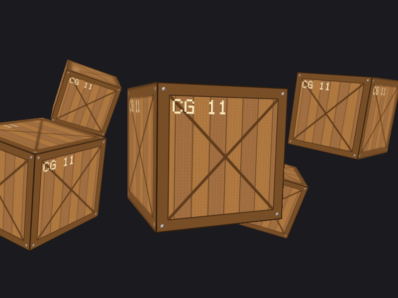
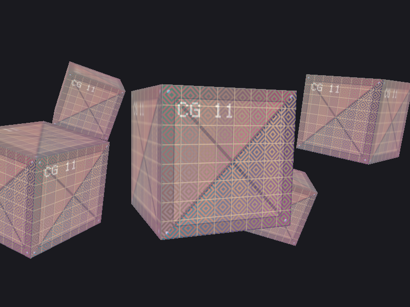
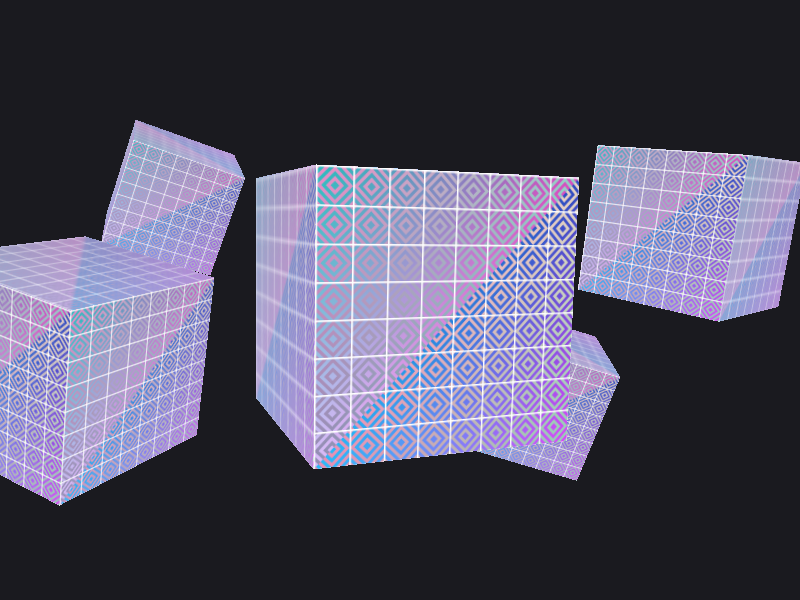

# 12-апта: екі текстураны біріктіру, blend коэффициенті uniform арқылы

C++17 · OpenGL 3.3 Core · GLFW · GLEW · GLM · stb_image · CMake (Ubuntu / WSL)

```bash
sudo apt install build-essential cmake libglfw3-dev libglew-dev libglm-dev
cmake -S . -B build && cmake --build build
./build/cg
```

Іске қосқанда терминалда үш сурет жүктелгені жазылады:

```
.../container.png  512x512  арна: 3
.../pattern.png    512x512  арна: 3
.../logo.png       512x512  арна: 4
tex1 = 1   tex2 = 2   tex3 = 3
```

> **Суреттер туралы.** Тапсырмамен берілген `pattern.png` мен `logo.png` қолымда болмағандықтан, оларды `tools/make_assets.py`
> жасайды: `pattern.png` — түрлі-түсті ромб өрнек (RGB), `logo.png` — мөлдір фонды призма белгісі (RGBA, 4 арна, шеттері жұмсақ:
> альфасы аралық мәнді 32 887 пиксель). `container.png` — 11-аптадағы файл. Ресми файлдар болса, `assets/` ішіне қойса жеткілікті.

Басқару: `W A S D`, `Space`/`Left Shift`, `Left Ctrl`, тінтуір, дөңгелек, `Esc`; **`↑` / `↓` — blend (dt-ге көбейтілген, 0..1 шектелген)**;
`1`…`8` — араластыру тәсілі (1 mix · 2 a·b · 3 a+b · 4 clamp(a+b) · 5 логотип · 6 mix(a,b,uv.y) · 7 smoothstep · 8 үш текстура);
`L` — екінші текстураны pattern ↔ logo; `B` — blend автоматты; `R` — логотипті айналдыру; `G` — әр жаққа бөлек blend.

## Базалық бөлім

`loadTexture` 11-аптадан өзгеріссіз. `texture1`/`texture2` — бірлік нөмірлері (0, 1) `glUseProgram`-нан **кейін** беріледі; render циклінде
`glActiveTexture` әрқашан `glBindTexture`-дан бұрын; `blend` — `0.5f * dt`, 0..1 аралығына шектелген; `glUniform1f(blend)` render циклінде.

| `01-blend-0.png` — тек жәшік | `02-blend-05.png` — жартылай | `03-blend-1.png` — тек өрнек |
|---|---|---|
|  |  |  |

## Скриншоттар мен командалар

| Файл | Тапсырма | Команда (`--shot a.ppm` қосылады) |
|---|---|---|
| `01`, `02`, `03` | базалық | `--blend 0` / `--blend 0.5` / `--blend 1` |
| `04-broken-units.png`, `04b-broken-units-blend1.png` | 1 | `--broken-units --blend 0` / `--blend 1` |
| `05-wrong-id.png` | 2 | `--wrong-id --blend 0.5` |
| `06-multiply.png`, `07-add.png`, `07b-add-clamp.png` | 3 | `--mode 2` / `--mode 3` / `--mode 4` |
| `08-decal.png` | 4 | `--mode 5 --tex2 logo` |
| `09-gradient.png`, `10-smoothstep.png` | 5 | `--mode 6` / `--mode 7` |
| `Q1-three-textures.png`, `Q3-per-face.png`, `Q4-rotating-logo.png` | Қ1, Қ3, Қ4 | `--three` / `--per-face` / `--mode 5 --tex2 logo --rotate --time 0.8` |

## 1-тапсырма. Бірліктерді әдейі шатастыру

Екі `glActiveTexture` жолы алынып тасталды (`--broken-units`). Бағдарлама құрастырылады, қате хабарламасы жоқ.

- **`blend = 0`** (`04-broken-units.png`): **pattern** көрінеді (`mix(a, b, 0) = a = texture1`).
- **`blend = 1`** (`04b-broken-units-blend1.png`): **толық қара** (`mix(a, b, 1) = b = texture2`).

Себебі: `glActiveTexture` шақырылмағандықтан екі `glBindTexture` да **0-бірлікке** түседі: алдымен `tex1`, одан кейін `tex2` — ол `tex1`-ді ығыстырады.
Нәтижесінде **0-бірлікте — `tex2` (pattern)**, **1-бірлікте — ештеңе жоқ**:

```
бірлік 0  ←  tex2 (pattern)     ← texture1 sampler осыны оқиды  → pattern
бірлік 1  ←  (бос)              ← texture2 sampler осыны оқиды  → қара (0,0,0,1)
```

> Тапсырмадағы «күтілетін жауап» екі жағдайда да tex2 көрінеді деп жазады. Менде нақты нәтиже басқаша: `texture1` 0-бірліктен pattern оқиды
> (`blend = 0` → pattern), ал `blend = 1` кезінде араластыру толық екінші sampler-ге тең, ал ол бос 1-бірлікті оқиды → қара. Скриншоттар осыны дәлелдейді.

## 2-тапсырма. Қатерлі қате

`glUniform1i(…"texture2"…, tex2)` — бірлік нөмірінің орнына ID берілді. Терминалда: **`tex1 = 1   tex2 = 2   tex3 = 3`**.
`texture2` sampler 2-бірлікті оқиды, ол бос → қара: `05-wrong-id.png`-те (`blend = 0.5`) жәшік жартылай қараңғы.

**Қорғау сұрағы.** `tex2` ID-і **2** болды. Егер ол кездейсоқ **1** болса, код **жұмыс істеп кетер еді** (ID мен бірлік нөмірі сәйкес келеді), сондықтан қатені байқамаймыз.
Қауіпті жері: қате жазылған сәтте емес, **кейін** — үшінші текстура қосылғанда немесе жүктеу реті/ID-лер ығысқанда пайда болады, ал OpenGL ештеңе айтпайды.
Сондықтан бірлік нөмірін әрқашан әріппен — `0`, `1` деп жазу керек.

## 3-тапсырма. Төрт араластыру тәсілі

`06-multiply.png` (a·b), `07-add.png` (a + b), `07b-add-clamp.png` (clamp(a + b, 0, 1)), `02-blend-05.png` (mix). `07` бетін аппақ қылады.
Шектеусіз қосу мен `clamp` экранда бірдей көрінеді (файл өлшемдері де бірдей): әдепкі framebuffer (8 бит) шығысты өзі 1.0-ге қияды.
Айырмашылық аралық есептеулерде (HDR, келесі амал алдында) пайда болады — онда `clamp` ақпаратты жояды, `a + b` > 1 мәні сақталады.

**Қорғау сұрағы.** Көбейту тек қараңғылатады, себебі екі сан да 0..1 аралығында болса, көбейтінді әрқайсысынан **кіші немесе тең**: `a·b ≤ min(a, b)`
(мысалы, 0.5 · 0.5 = 0.25). Түс арнасына 1-ден үлкен көбейткіш ешқашан келмейді, сондықтан сурет ашылмайды.
**Көбейту** — кір, дақ, көлеңке, тозу (қараңғылату) үшін жарайды; **қосу** — жалын, жарық, жарқыл, от (жарықтандыру) үшін.

## 4-тапсырма. Логотипті альфамен жапсыру

`logo.png` терминалда **«арна: 4»** деп жүктеледі, `fmt = GL_RGBA`. Шейдерде `FragColor = mix(base, decal, decal.a)` — `08-decal.png`:
жәшіктің бетінде призма, фоны мөлдір, шеттері жұмсақ.

**Қорғау сұрағы.** Коэффициент — әр фрагменттің `decal.a`-сы. Үш жағдай:
1. `a = 0` — логотиптің мөлдір фоны: **жәшік** көрінеді;
2. `a = 1` — логотиптің қатты бөлігі (призма денесі, ақ жиек): **логотип** көрінеді;
3. `0 < a < 1` — логотиптің шеттері (жұмсақ жиек): жәшік пен логотиптің **жұмсақ ауысуы**. Менің логотипімде аралық альфасы бар 32 887 пиксель бар.

## 5-тапсырма. Кеңістіктік ауысу

`09-gradient.png` — `mix(a, b, vTexCoord.y)`; `10-smoothstep.png` — `smoothstep(0.3, 0.7, vTexCoord.y)` (ауысу тар, ортада жылдам, шеттерінде тегіс).

**Қорғау сұрағы.** Ойындарда: ландшафт текстураларын араластыру (шөптен тасқа, құмнан шөпке), таудың басындағы қар, қабырғаның төменгі жағындағы ылғал/кір,
жол мен шөптің шекарасы. Ауысуды кездейсоқ (біркелкі емес) ету үшін коэффициентті **үшінші текстурадан** — араластыру картасынан (blend/splat map,
мысалы шу текстурасы) аламын: `float t = texture(mask, vTexCoord).r; mix(a, b, t)`. Бұл 14-аптадағы жылтырлық картасының дәл сол идеясы.

## Орындалған қосымша тапсырмалар

- **Қ1.** `--three` / `8` пернесі: `container + pattern + logo`; `GL_TEXTURE2` қосылды (`Q1-three-textures.png`). Осы кезде ID шатасуының қаншалықты қауіпті екені көрінеді: 3 текстура болғанда `tex2 = 2` енді шынымен 2-бірлікке сәйкес келеді.
- **Қ2.** `B` — `blend = 0.5 + 0.5·sin(time)`; перне күйі `prev[]` арқылы сақталады (10-аптадағы әдіс). Кодта бар, интерактивті режимде көзбен сынаған жоқпын.
- **Қ3.** `--per-face` / `G` — әр куб 6 рет сызылады, `blend = f / 5` (`Q3-per-face.png`).
- **Қ4.** `--rotate` / `R` — UV шейдерде бұрылады; логотип текстурасы `GL_CLAMP_TO_BORDER` + мөлдір шекара түсімен (`Q4-rotating-logo.png`).
